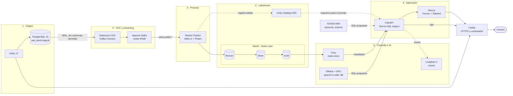

# Odoo Data Lakehouse

Plataforma analítica local que replica Odoo 17 casi en tiempo real en un lakehouse abierto y permite consultarlo en lenguaje natural. Funciona en un solo equipo con Docker Compose y un modelo de lenguaje local: por defecto, los datos del ERP no salen del host.

> **Estado: Fase 1 completada, origen y CDC.** Odoo, PostgreSQL, Kafka, Debezium, MinIO, Langfuse y Caddy están configurados y probados en ejecución: un cambio en Odoo llega a Kafka en torno a un segundo. El worker, la API y el frontend son esqueletos funcionales. El detalle de lo que falta por probar está en [TD-020](docs/TECHNICAL_DEBT.md#td-020).

- [Objetivos](#objetivos)
- [Arquitectura](#arquitectura)
- [Requisitos](#requisitos)
- [Puesta en marcha](#puesta-en-marcha)
- [Proveedor de LLM](#proveedor-de-llm)
- [Exposición para la defensa del TFG](#exposición-para-la-defensa-del-tfg)
- [Estructura del repositorio](#estructura-del-repositorio)
- [Hoja de ruta](#hoja-de-ruta)
- [Documentación](#documentación)

## Objetivos

- **Capturar los cambios de Odoo sin cargar el ERP**, leyendo el WAL de PostgreSQL con Debezium.
- **Construir una arquitectura Medallion** en Delta Lake: Bronze con todas las tablas, Silver y Gold con los dominios de negocio.
- **Responder preguntas en lenguaje natural** con SQL generado por un LLM y validado antes de ejecutarse.
- **Mostrar los resultados** en un dashboard conversacional.
- **Respetar un presupuesto fijo de hardware**: cada contenedor tiene un límite de memoria y la suma cabe en el equipo.

Dominios del MVP: ventas, facturación, inventario, CRM y datos maestros.

## Arquitectura



1. **Origen.** Odoo escribe en PostgreSQL con replicación lógica activada.
2. **CDC y streaming.** Debezium captura todas las tablas del esquema `public`, salvo las columnas con secretos, y publica un topic por tabla en Kafka.
3. **Proceso.** Un worker ligero en Python consume los eventos y escribe Delta Lake. No hay Spark.
4. **Lakehouse.** MinIO guarda Bronze, Silver y Gold. Unity Catalog OSS guarda los metadatos.
5. **Consulta e IA.** El LLM propone el SQL y Trino lo ejecuta sobre Gold. Langfuse guarda las trazas.
6. **Aplicación.** FastAPI valida el SQL (solo `SELECT` o `WITH` sobre Gold) y Next.js muestra el resultado.
7. **Entrada.** Caddy es el único servicio accesible desde fuera, y solo cuando se pide.

El detalle de cada flujo, las versiones y los controles de seguridad están en [docs/ARCHITECTURE.md](docs/ARCHITECTURE.md).

## Requisitos

### Hardware

| Recurso | Equipo de referencia | Comentario |
|---|---|---|
| CPU | AMD Ryzen 5 5600 (6 núcleos, 12 hilos) | |
| RAM | 32 GB DDR4 | 22 GB para WSL 2 |
| GPU | NVIDIA GTX 1060, 6 GB | El modelo 3B cabe en la VRAM libre ([TD-001](docs/TECHNICAL_DEBT.md#td-001)) |
| Disco | 60 GB libres en la unidad donde Docker guarda sus datos | Imágenes, modelo y datos |

### Software

- Windows 11 con WSL 2 y Ubuntu 24.04.
- Docker Desktop con la integración de WSL activada para Ubuntu.
- Controlador NVIDIA 570 o superior en Windows. No hay que instalar controladores dentro de WSL.

### Preparar el equipo

Por defecto, WSL usa solo el 50 % de la RAM, que no basta para este proyecto. En `C:\Users\<usuario>\.wslconfig`:

```ini
[wsl2]
memory=22GB
processors=10
swap=4GB
```

La guía completa está en [docs/SETUP_WSL.md](docs/SETUP_WSL.md): `.wslconfig`, `/etc/wsl.conf`, permisos, Docker Desktop y espacio en disco. El diagnóstico solo lee y dice qué falta:

```bash
bash scripts/check_env.sh --gpu
```

### Presupuesto de memoria

| Capa | Servicios | Límite (MiB) |
|---|---|---:|
| Origen | PostgreSQL, Odoo | 2560 |
| Streaming | Kafka, Debezium Connect | 2560 |
| Lakehouse | MinIO, Unity Catalog | 1792 |
| Consulta | Trino (heap de 4 GB) | 5120 |
| IA | Ollama | 4096 |
| Aplicación | Worker, FastAPI, Next.js | 2560 |
| Observabilidad | Langfuse y su base de datos | 1024 |
| Entrada | Caddy | 128 |
| **Total** | | **19840** |
| **Reserva de WSL** | | **2688** |

El desglose por contenedor y el presupuesto de VRAM están en [CLAUDE.md](CLAUDE.md#presupuesto-de-memoria).

## Puesta en marcha

Desde Ubuntu, en la raíz del repositorio:

```bash
git clone https://github.com/mikest376/ProyectoCasa.git
cd ProyectoCasa
cp .env.example .env && chmod 600 .env
# Edita .env y sustituye todos los CHANGE_ME (openssl rand -hex 24)

bash scripts/check_env.sh          # 0 fallos antes de continuar
```

**Origen y CDC:**

```bash
bash scripts/init_odoo.sh                                  # PostgreSQL, Odoo, módulos y cierre de accesos por defecto
docker compose --profile streaming up -d --wait            # Kafka y Debezium Connect
python3 scripts/cdc.py register                            # comprueba secretos, prepara PostgreSQL y da de alta el conector
python3 scripts/cdc.py status
```

**Servicios propios y entrada:**

```bash
docker compose --profile apps up -d --build --wait
docker compose --profile caddy up -d                       # solo en 127.0.0.1
```

Los servicios se agrupan en perfiles y nada arranca sin elegir uno:

| Perfil | Servicios | Estado |
|---|---|---|
| `source` | PostgreSQL, Odoo | Probado |
| `streaming` | Kafka, Debezium Connect | Probado |
| `lakehouse` | MinIO, Unity Catalog | MinIO probado; Unity Catalog en la Fase 3 |
| `apps` | Worker, FastAPI, Next.js | Esqueletos probados |
| `observability` | Langfuse 2 | Probado |
| `caddy` | Caddy | Probado en `127.0.0.1` |
| `query` | Trino | Catálogo probado; se activa en la Fase 3 |
| `ai` | Ollama | Fase 4 |

| Interfaz | Dirección |
|---|---|
| Odoo | `http://localhost:8069` |
| Frontend | `http://localhost:3000` |
| FastAPI (documentación) | `http://localhost:8000/docs` |
| MinIO | `http://localhost:9001` |
| Langfuse | `http://localhost:3001` |
| A través de Caddy | `https://app.localhost` y `https://odoo.localhost` |

```bash
docker compose --profile "*" down     # parar todo, conservando los datos
bash scripts/validate.sh              # lint, tipos, pruebas y configuración
```

Tras instalar módulos de Odoo hay que repetir `python3 scripts/cdc.py register`: prepara las tablas nuevas y comprueba que no añaden columnas con secretos.

## Proveedor de LLM

Se elige con `LLM_PROVIDER` en `.env`:

| | `ollama` (por defecto) | `nim` |
|---|---|---|
| Dónde se ejecuta | En este equipo, con GPU | API de NVIDIA |
| Modelo | `qwen2.5-coder:3b-instruct-q4_K_M` | `nvidia/nemotron-3.5-lightning-30b-a3b` |
| Qué sale del host | Nada | El esquema de Gold y la pregunta |
| Clave | No | `NIM_API_KEY` |

Los [términos de prueba de NVIDIA](https://assets.ngc.nvidia.com/products/api-catalog/legal/NVIDIA%20API%20Trial%20Terms%20of%20Service.pdf) solo permiten pruebas y evaluación, prohíben enviar datos personales o confidenciales, y autorizan a NVIDIA a usar lo enviado para mejorar sus productos, incluidos sus modelos. Una pregunta como «ventas a Juan Pérez» ya contiene un dato personal. Usa `nim` solo con datos de demostración ([TD-021](docs/TECHNICAL_DEBT.md#td-021)).

## Exposición para la defensa del TFG

Durante la presentación se pueden publicar Odoo y el frontend a través de Caddy, con los puertos 80 y 443 del router redirigidos a este equipo (`192.168.1.24`). **Es una excepción temporal** a la regla de no exponer nada sin autenticación propia ([TD-009](docs/TECHNICAL_DEBT.md#td-009), [TD-022](docs/TECHNICAL_DEBT.md#td-022)).

### Qué queda accesible

| | |
|---|---|
| **Sí**, con contraseña | Odoo y el frontend, con `/api` hacia FastAPI |
| **No** | PostgreSQL, Kafka, Debezium, MinIO, Unity Catalog, Trino, Ollama, Langfuse y la documentación de FastAPI |
| **Bloqueado en Odoo**, incluso con contraseña | Gestor de bases de datos, `/xmlrpc`, `/jsonrpc`, registro y recuperación de contraseña |

### Riesgos

- **El equipo queda en Internet.** Los rastreadores llegan en minutos: emitir un certificado público anuncia el dominio.
- **Una sola contraseña compartida**, sin cuentas por persona ni límite de intentos.
- **Odoo 17 no recibe parches de seguridad** ([TD-012](docs/TECHNICAL_DEBT.md#td-012)).
- **Docker Desktop oculta la IP del cliente**: Caddy no puede filtrar ni bloquear por IP.
- **La red doméstica es la misma**: un fallo en un servicio expuesto es un punto de apoyo dentro de ella.

### Antes

1. Solo datos de demostración. Nada real, ni en Odoo ni en las preguntas.
2. `bash scripts/init_odoo.sh`: cambia la contraseña de `admin` e invalida las de `demo` y `portal`.
3. Contraseña de acceso larga y única. Genera su hash y ponlo en `.env` entre comillas simples:

   ```bash
   docker run --rm -it caddy:2.11.9-alpine caddy hash-password
   ```

4. En `.env`: `CADDY_APP_HOST` y `CADDY_ODOO_HOST` con los dominios públicos, `CADDY_TLS` con un correo (activa Let's Encrypt) y `CADDY_BIND_IP=192.168.1.24`.
5. En el router, redirige **solo** 80 y 443 a `192.168.1.24`. Sin DMZ ni UPnP. En el firewall de Windows, permite solo esos dos puertos en el perfil de red activo.
6. Arranca y comprueba. Si algo falla, no expongas:

   ```bash
   docker compose --profile source --profile apps up -d --wait
   docker compose --profile caddy up -d
   read -rsp 'Contraseña de acceso: ' CADDY_CHECK_PASSWORD && export CADDY_CHECK_PASSWORD
   python3 scripts/check_exposure.py; unset CADDY_CHECK_PASSWORD
   ```

7. Prueba desde fuera de casa, por ejemplo con los datos del móvil.

### Durante

- Expón lo imprescindible: minutos antes, no días antes.
- Vigila los accesos: `docker compose logs -f caddy`.
- **Corte inmediato:** `docker compose --profile caddy stop caddy`.

### Después

1. `docker compose --profile caddy down` y vuelve a poner `CADDY_BIND_IP=127.0.0.1`.
2. Elimina las redirecciones del router y las reglas del firewall.
3. Cambia las contraseñas usadas.

Caddy no se reinicia solo: tras apagar el equipo, la exposición no se reanuda.

## Estructura del repositorio

```text
.
├── CLAUDE.md                  Reglas de arquitectura, presupuestos y convenciones
├── README.md
├── docker-compose.yml         Servicios, perfiles, redes y límites de memoria
├── .env.example               Plantilla de variables de entorno
├── docs/
│   ├── ARCHITECTURE.md        Diseño, diagramas, versiones y decisiones
│   ├── SETUP_WSL.md           Preparación de WSL 2 y Docker
│   └── TECHNICAL_DEBT.md      Registro de deuda técnica
├── infra/
│   ├── caddy/                 Entrada externa
│   ├── debezium/              Conector CDC y columnas excluidas
│   ├── odoo/                  Arranque, inicialización y cierre de accesos
│   ├── postgres/              Configuración, roles y preparación del CDC
│   ├── trino/                 JVM, límites de consulta y catálogos
│   └── unity-catalog/         Catálogo de metadatos
├── services/
│   ├── medallion-worker/      Kafka → Delta Lake (Bronze, Silver, Gold)
│   ├── backend/               FastAPI y proveedores de LLM
│   └── frontend/              Next.js
└── scripts/                   Diagnóstico, inicialización, CDC y validación
```

## Hoja de ruta

| Fase | Contenido | Criterio de salida | Estado |
|---|---|---|---|
| **0** | Base arquitectónica | Compose válido, presupuestos y deuda documentados | Completada |
| **1** | Origen y CDC: Odoo, PostgreSQL, Kafka, Debezium | Un cambio en Odoo aparece en Kafka en menos de 5 s | Completada |
| **2** | Bronze: worker, MinIO e integración continua | Todas las tablas en Delta; un reinicio no pierde eventos | Pendiente |
| **3** | Silver, Gold, Unity Catalog y Trino | Los cinco dominios se consultan desde Trino | Pendiente |
| **4** | Text-to-SQL: LLM, FastAPI y Langfuse | Conjunto de evaluación superado y SQL peligroso rechazado | Pendiente |
| **5** | Dashboard conversacional: Next.js y Tremor | De la pregunta al gráfico, de extremo a extremo | Pendiente |
| **6** | Endurecimiento: JWT, TLS interno, observabilidad, copias | Deuda de severidad Alta pagada | Pendiente |

## Documentación

| Documento | Contenido |
|---|---|
| [docs/ARCHITECTURE.md](docs/ARCHITECTURE.md) | Flujos, Medallion, seguridad, puertos y versiones |
| [docs/SETUP_WSL.md](docs/SETUP_WSL.md) | WSL 2, permisos, Docker Desktop y espacio en disco |
| [docs/TECHNICAL_DEBT.md](docs/TECHNICAL_DEBT.md) | Deuda asumida y plan de pago |
| [CLAUDE.md](CLAUDE.md) | Reglas para contribuir, con o sin agentes de IA |

## Licencia

Sin definir. Hasta que se publique una licencia, todos los derechos están reservados.
