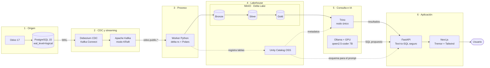

# Odoo Data Lakehouse

Plataforma analítica local que replica Odoo 17 casi en tiempo real en un lakehouse abierto y permite consultarlo en lenguaje natural. Funciona en un solo equipo con Docker Compose y un modelo de lenguaje local: los datos del ERP no salen del host.

> **Estado: Fase 0, base arquitectónica.** El repositorio contiene el diseño, los presupuestos de recursos y la configuración estructural. Los servicios propios aún no tienen código y el compose está validado, pero no se ha probado en ejecución ([TD-020](docs/TECHNICAL_DEBT.md#td-020)).

- [Objetivos](#objetivos)
- [Arquitectura](#arquitectura)
- [Requisitos](#requisitos)
- [Puesta en marcha](#puesta-en-marcha)
- [Estructura del repositorio](#estructura-del-repositorio)
- [Hoja de ruta](#hoja-de-ruta)
- [Documentación](#documentación)

## Objetivos

- **Capturar los cambios de Odoo sin cargar el ERP**, leyendo el WAL de PostgreSQL con Debezium.
- **Construir una arquitectura Medallion** en Delta Lake: Bronze con todas las tablas, Silver y Gold con los dominios de negocio.
- **Responder preguntas en lenguaje natural** con SQL generado por un LLM local y validado antes de ejecutarse.
- **Mostrar los resultados** en un dashboard conversacional.
- **Respetar un presupuesto fijo de hardware**: cada contenedor tiene un límite de memoria y la suma cabe en el equipo.

Dominios del MVP: ventas, facturación, inventario, CRM y datos maestros.

## Arquitectura



1. **Origen.** Odoo escribe en PostgreSQL con replicación lógica activada.
2. **CDC y streaming.** Debezium captura todas las tablas del esquema `public` y publica un topic por tabla en Kafka.
3. **Proceso.** Un worker ligero en Python consume los eventos y escribe Delta Lake. No hay Spark.
4. **Lakehouse.** MinIO guarda Bronze, Silver y Gold. Unity Catalog OSS guarda los metadatos. Su conexión con Trino está pendiente de decisión ([TD-002](docs/TECHNICAL_DEBT.md#td-002)).
5. **Consulta e IA.** Ollama propone el SQL y Trino lo ejecuta sobre Gold.
6. **Aplicación.** FastAPI valida el SQL (solo `SELECT` o `WITH` sobre Gold) y Next.js muestra el resultado.

El detalle de cada flujo, las versiones y los controles de seguridad están en [docs/ARCHITECTURE.md](docs/ARCHITECTURE.md).

## Requisitos

### Hardware

| Recurso | Equipo de referencia | Comentario |
|---|---|---|
| CPU | AMD Ryzen 5 5600 (6 núcleos, 12 hilos) | |
| RAM | 32 GB DDR4 | 22 GB para WSL 2 |
| GPU | NVIDIA GTX 1060, 6 GB | 8 GB recomendados para el modelo 7B completo en GPU ([TD-001](docs/TECHNICAL_DEBT.md#td-001)) |
| Disco | 60 GB libres | Imágenes, modelo y datos |

### Software

- Windows 11 con WSL 2 y Ubuntu 24.04.
- Docker Desktop con la integración de WSL activada para Ubuntu (*Settings → Resources → WSL Integration*).
- Controlador NVIDIA 570 o superior en Windows. No hay que instalar controladores dentro de WSL.

### Configuración de `.wslconfig`

Por defecto, WSL usa solo el 50 % de la RAM, que no basta para este proyecto. Crea o edita `C:\Users\<usuario>\.wslconfig`:

```ini
[wsl2]
memory=22GB
processors=10
swap=4GB
```

Aplica el cambio desde PowerShell. Cierra todas las distribuciones, incluida la de Docker Desktop:

```powershell
wsl --shutdown
```

Comprueba el resultado desde Ubuntu:

```bash
free -h       # unos 22 GiB de memoria total
nvidia-smi    # debe aparecer la GPU
```

### Presupuesto de memoria

| Capa | Servicios | Límite (MiB) |
|---|---|---:|
| Origen | PostgreSQL, Odoo | 2560 |
| Streaming | Kafka, Debezium Connect | 2560 |
| Lakehouse | MinIO, Unity Catalog | 1792 |
| Consulta | Trino (heap de 4 GB) | 5120 |
| IA | Ollama | 5120 |
| Aplicación | Worker, FastAPI, Next.js | 2560 |
| **Total** | | **19712** |
| **Reserva de WSL** | | **2816** |

El desglose por contenedor y el presupuesto de VRAM están en [CLAUDE.md](CLAUDE.md#presupuesto-de-memoria).

## Puesta en marcha

```bash
git clone https://github.com/mikest376/ProyectoCasa.git
cd ProyectoCasa

cp .env.example .env
# Edita .env y sustituye todos los CHANGE_ME (por ejemplo, con: openssl rand -hex 24)

docker compose --profile "*" config --quiet && echo "Configuración válida"
```

Los servicios se agrupan en perfiles y nada arranca sin elegir uno:

| Perfil | Servicios | Se valida en |
|---|---|---|
| `source` | PostgreSQL, Odoo | Fase 1 |
| `streaming` | Kafka, Debezium Connect | Fase 1 |
| `lakehouse` | MinIO, Unity Catalog | Fases 2 y 3 |
| `query` | Trino | Fase 3 |
| `ai` | Ollama | Fase 4 |
| `apps` | Worker, FastAPI, Next.js | Fases 2 a 5 (sin Dockerfile todavía) |

```bash
docker compose --profile source --profile streaming up -d   # arrancar dos capas
docker compose --profile "*" down                           # parar todo, conservando los datos
```

> El MVP no tiene autenticación ([TD-009](docs/TECHNICAL_DEBT.md#td-009)) y la captura global copia datos sensibles ([TD-004](docs/TECHNICAL_DEBT.md#td-004)). Usa solo datos de demostración y no expongas los puertos fuera de `127.0.0.1`.

## Estructura del repositorio

```text
.
├── CLAUDE.md                  Reglas de arquitectura, presupuestos y convenciones
├── README.md
├── docker-compose.yml         Servicios, perfiles y límites de memoria
├── .env.example               Plantilla de variables de entorno
├── docs/
│   ├── ARCHITECTURE.md        Diseño, diagramas, versiones y decisiones
│   └── TECHNICAL_DEBT.md      Registro de deuda técnica
├── infra/
│   ├── postgres/              Configuración de PostgreSQL y scripts de inicio
│   ├── debezium/              Conector CDC
│   ├── trino/                 JVM, límites de consulta y catálogos
│   └── unity-catalog/         Catálogo de metadatos
├── services/
│   ├── medallion-worker/      Kafka → Delta Lake (Bronze, Silver, Gold)
│   ├── backend/               FastAPI, Ollama y cliente de Trino
│   └── frontend/              Next.js, Tailwind y Tremor
└── scripts/                   Arranque, registro de conectores y semillas
```

## Hoja de ruta

| Fase | Contenido | Criterio de salida | Estado |
|---|---|---|---|
| **0** | Base arquitectónica | Compose válido, presupuestos y deuda documentados | Completada |
| **1** | Origen y CDC: Odoo, PostgreSQL, Kafka, Debezium | Un cambio en Odoo aparece en Kafka en menos de 5 s | Pendiente |
| **2** | Bronze: MinIO, worker e integración continua | Todas las tablas en Delta; un reinicio no pierde eventos | Pendiente |
| **3** | Silver, Gold, Unity Catalog y Trino | Los cinco dominios se consultan desde Trino | Pendiente |
| **4** | Text-to-SQL: Ollama y FastAPI | Conjunto de evaluación superado y SQL peligroso rechazado | Pendiente |
| **5** | Dashboard conversacional: Next.js y Tremor | De la pregunta al gráfico, de extremo a extremo | Pendiente |
| **6** | Endurecimiento: JWT, TLS, observabilidad, copias | Deuda de severidad Alta pagada | Pendiente |

## Documentación

| Documento | Contenido |
|---|---|
| [docs/ARCHITECTURE.md](docs/ARCHITECTURE.md) | Flujos, Medallion, seguridad, puertos y versiones |
| [docs/TECHNICAL_DEBT.md](docs/TECHNICAL_DEBT.md) | Deuda asumida y plan de pago |
| [CLAUDE.md](CLAUDE.md) | Reglas para contribuir, con o sin agentes de IA |

## Licencia

Sin definir. Hasta que se publique una licencia, todos los derechos están reservados.
