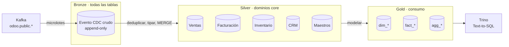
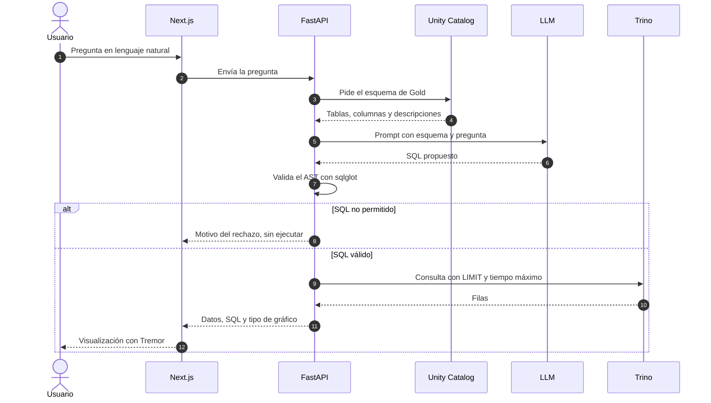

# Arquitectura

Detalle técnico del proyecto. La vista general está en el [README](../README.md#arquitectura) y las reglas de obligado cumplimiento, en [CLAUDE.md](../CLAUDE.md).

## Principios

1. **El ERP no se toca.** La captura lee el WAL de PostgreSQL; no hay consultas analíticas contra Odoo.
2. **Bronze es la fuente de reproceso.** Conserva el evento crudo, así que Silver y Gold se pueden reconstruir.
3. **Los secretos no entran en el lakehouse.** Se excluyen antes de llegar a Kafka.
4. **El hardware manda.** Cada contenedor tiene un límite y la suma cabe en la RAM asignada a WSL.
5. **El SQL del modelo no es de confianza.** Se valida en varias capas antes de ejecutarse.
6. **Nada se expone por accidente.** Salir de `127.0.0.1` exige un cambio explícito.
7. **Formatos abiertos.** Delta Lake sobre S3, sin dependencia de un motor concreto.

## Componentes y versiones

Tags comprobados en sus registros el 2026-11-24.

| Componente | Imagen | Función |
|---|---|---|
| PostgreSQL | `postgres:15.20-bookworm` | Base de datos de Odoo con `wal_level=logical`, y de Langfuse |
| Odoo | `odoo:17.0-20260908` | ERP de origen ([TD-012](TECHNICAL_DEBT.md#td-012)) |
| Kafka | `apache/kafka:4.3.2` | Bus de eventos en modo KRaft |
| Debezium | `quay.io/debezium/connect:3.7.1.Final` | CDC. Incluye Kafka Connect 4.3.1 |
| MinIO | `cgr.dev/chainguard/minio` (digest) | Almacenamiento S3 ([TD-003](TECHNICAL_DEBT.md#td-003)) |
| Unity Catalog OSS | `unitycatalog/unitycatalog:v0.7.0` | Catálogo de metadatos |
| Trino | `trinodb/trino:484` | Motor de consulta, nodo único |
| Ollama | `ollama/ollama:0.40.18` | LLM local con GPU |
| Langfuse | `langfuse/langfuse:2.95.11` | Trazas del LLM ([TD-023](TECHNICAL_DEBT.md#td-023)) |
| Caddy | `caddy:2.11.9-alpine` | Entrada externa ([TD-022](TECHNICAL_DEBT.md#td-022)) |
| Worker y backend | `python:3.13.18-slim-bookworm` | Servicios propios |
| Frontend | `node:24.22.3-alpine` | Next.js 16 |
| NVIDIA NIM | API externa | LLM opcional ([TD-021](TECHNICAL_DEBT.md#td-021)) |

## Origen

| Rol de PostgreSQL | Permisos | Uso |
|---|---|---|
| `postgres` | Superusuario | Administración y preparación del CDC, solo desde el contenedor |
| `odoo` | Propietario de su base | Odoo |
| `debezium` | `REPLICATION` y `SELECT` | Debezium |

`scripts/init_odoo.sh` instala los módulos con datos de demostración y cierra los accesos por defecto: contraseña nueva para `admin` y contraseñas aleatorias para `demo` y `portal`.

## Ingesta CDC

La configuración está en `infra/debezium/`. `scripts/cdc.py register` la completa y la aplica:

1. Asigna `REPLICA IDENTITY FULL` a las tablas sin clave primaria ([TD-005](TECHNICAL_DEBT.md#td-005)).
2. Crea la publicación para el esquema `public`.
3. Compara el esquema real con `column-exclude.list` y **se detiene** si alguna columna sospechosa quedaría sin excluir ([TD-004](TECHNICAL_DEBT.md#td-004)).
4. Da de alta el conector y espera a que esté en marcha.

| Propiedad | Valor | Motivo |
|---|---|---|
| `plugin.name` | `pgoutput` | Incluido en PostgreSQL |
| `schema.include.list` | `public` | Captura global, sin `table.include.list` |
| `column.exclude.list` | `column-exclude.list` | Sin contraseñas, claves, tokens ni credenciales de correo |
| `publication.autocreate.mode` | `disabled` | La publicación se prepara aparte; el rol no necesita más permisos |
| `snapshot.mode` | `initial` | Carga inicial y después cambios |
| `decimal.handling.mode` | `string` | Decimales exactos. Por defecto llegan como binario en base64 |
| `heartbeat.interval.ms` | `10000` | Avanza el slot con poco tráfico ([TD-006](TECHNICAL_DEBT.md#td-006)) |
| `topic.creation.default.*` | 1 partición, réplica 1 | El broker no crea topics por su cuenta |
| `database.password` | `${env:DEBEZIUM_DB_PASSWORD}` | La contraseña no aparece en el JSON ni en la API de Connect |

Los topics siguen el patrón `odoo.public.<tabla>`. Solo existe el topic de una tabla cuando ha tenido al menos una fila.

## Medallion

| | Bronze | Silver | Gold |
|---|---|---|---|
| Ruta | `s3://bronze/odoo/<tabla>` | `s3://silver/<dominio>/<tabla>` | `s3://gold/<dominio>/<modelo>` |
| Alcance | Todas las tablas | Dominios core | Dominios core |
| Escritura | Append | MERGE por clave primaria | Sobrescritura o MERGE |
| Contenido | Evento crudo | Estado actual tipado | Modelo dimensional |
| Acceso de Text-to-SQL | No | No | Sí, solo lectura |

**Columnas de Bronze:** `_topic`, `_partition`, `_offset`, `_ingested_at`, `op`, `source_lsn`, `source_ts_ms`, `key`, `before` y `after`. Las tres últimas guardan JSON como texto. Los mensajes que no se pueden interpretar se guardan tal cual en `s3://bronze/odoo/_rejected`, con el motivo.

**Reglas de procesamiento**

- **Entrega al menos una vez.** El offset de Kafka se confirma, topic a topic y de forma explícita, después de su commit en Delta. Los duplicados se eliminan en Silver por `(_topic, _partition, _offset)`.
- **Append-only.** Las tablas Bronze llevan `delta.appendOnly=true`: el protocolo rechaza `UPDATE` y `DELETE`. Además, el usuario de MinIO del worker no puede borrar en ese bucket.
- **Memoria.** Un lote se cierra por número de eventos, por bytes o por tiempo, lo que ocurra antes.
- **Orden.** El estado más reciente de una fila es el de mayor `source_lsn`, no el último en llegar.
- **Borrados.** `op = 'd'` marca la fila con `_is_deleted`; no se elimina físicamente en Silver.
- **Valores TOAST.** Debezium envía `__debezium_unavailable_value` cuando un campo largo no ha cambiado. El MERGE conserva el valor anterior y nunca escribe ese marcador.
- **Concurrencia.** Un solo escritor. En MinIO, delta-rs usa escritura condicional (`aws_conditional_put=etag`), probada con la imagen fijada.

Desde la Fase 2, el worker escribe Bronze. Silver y Gold llegan en la Fase 3.

### Acceso a MinIO

`minio-init` crea los buckets y un usuario por servicio con su política mínima ([infra/minio](../infra/minio/README.md), [TD-014](TECHNICAL_DEBT.md#td-014)):

| Usuario | Bronze | Silver y Gold |
|---|---|---|
| Raíz (solo `minio` y `minio-init`) | Todo | Todo |
| Worker | Leer y añadir, sin borrar | Leer, escribir y borrar |
| Trino | Nada | Leer |

## Catálogo y consulta

Unity Catalog OSS es el catálogo de referencia: `lakehouse.silver` y `lakehouse.gold`, con tablas externas y descripciones de columnas. FastAPI lee de él el esquema que se incluye en el prompt.

Trino 484 no puede usar Unity Catalog OSS como metastore de tablas Delta. **Decisión: opción A de [TD-002](TECHNICAL_DEBT.md#td-002)**, un metastore en ficheros sobre MinIO con registro por `system.register_table` desde el worker. Está probada y se activa en la Fase 3.

## Text-to-SQL

| Capa | Control |
|---|---|
| Prompt | Solo contiene metadatos de Gold y la pregunta |
| AST (`sqlglot`) | Una sentencia `SELECT` o `WITH`, tablas en lista de permitidas, sin funciones de tabla |
| Backend | `LIMIT` y tiempo máximo obligatorios |
| Trino | Usuario `text2sql` con `SELECT` solo sobre Gold; límites de memoria y duración |
| MinIO | Credenciales de solo lectura para Trino ([TD-014](TECHNICAL_DEBT.md#td-014)) |

El control de acceso de Trino limita lo que puede hacer el usuario `text2sql`, pero no sustituye a la autenticación ([TD-009](TECHNICAL_DEBT.md#td-009)).

### Proveedores de LLM

`LLM_PROVIDER` elige entre Ollama (local, por defecto) y NVIDIA NIM (API externa compatible con OpenAI). El resto del backend solo conoce una interfaz común. `GET /api/llm` indica qué proveedor responde y si el prompt sale del host, y la interfaz lo muestra.

Desde la Fase 4, las llamadas se trazarán en Langfuse con el SDK de Python v2, la versión compatible con el servidor instalado.

## Red

| Red | Servicios |
|---|---|
| `edge-odoo` | Caddy, Odoo |
| `edge-app` | Caddy, frontend, backend |
| `source` | Odoo, su base de datos |
| `langfuse` | Langfuse, su base de datos |
| `lakehouse` | Base de datos de Odoo, Kafka, Connect, MinIO, Unity Catalog, Trino, Ollama, Langfuse, worker, backend |

Odoo y Caddy, los más expuestos, no alcanzan los servicios sin autenticación del plano de datos.

Los puertos se publican solo en `127.0.0.1`:

| Servicio | Dentro de la red | En el host |
|---|---|---|
| PostgreSQL (Odoo) | `odoo-db:5432` | 5433 |
| Odoo | `odoo:8069` | 8069 |
| Kafka | `kafka:19092` | 9092 |
| Kafka Connect | `kafka-connect:8083` | 8083 |
| MinIO (API / consola) | `minio:9000` / `minio:9001` | 9000 / 9001 |
| Unity Catalog | `unity-catalog:8080` | 8081 |
| Trino | `trino:8080` | 8080 |
| Ollama | `ollama:11434` | 11434 |
| FastAPI | `backend:8000` | 8000 |
| Next.js | `frontend:3000` | 3000 |
| Langfuse | `langfuse:3000` | 3001 |
| Caddy (HTTP / frontend / Odoo con un solo nombre) | `caddy:80` / `caddy:443` / `caddy:8443` | 80 / 443 / 8443 |

## Entrada externa

Caddy publica Odoo y el frontend, con `/api` hacia FastAPI. El procedimiento está en el [README](../README.md#exposición-para-la-defensa-del-tfg).

| Control | Detalle |
|---|---|
| Dirección | `127.0.0.1` salvo que se cambie `CADDY_BIND_IP` |
| Nombres | Uno por servicio en el 443, o uno solo: frontend en el 443 y Odoo en el 8443. El certificado es el mismo |
| Acceso | Contraseña en todas las rutas. Sin credenciales válidas no pasa nadie |
| Rutas de Odoo bloqueadas | Gestor de bases de datos, `/xmlrpc`, `/jsonrpc`, registro, recuperación de contraseña y pruebas |
| Tamaño de petición | 64 KB en la aplicación, 25 MB en Odoo |
| Credenciales | La cabecera `Authorization` no llega a Odoo ni a FastAPI, y se oculta en los logs. Las cookies no llegan al frontend ni a FastAPI |
| Cookies de Odoo | Caddy añade `Secure`: el navegador no las envía en claro al abrir `http://nombre` |
| Contenedor | Solo lectura, sin privilegios adicionales, sin API de administración y sin reinicio automático |
| Verificación | `scripts/tests/test_caddy.sh` con servicios simulados, y `scripts/check_exposure.py` con los reales |

## Particularidades de Odoo 17

- **Campos traducibles:** se guardan como JSONB por idioma, por ejemplo `product_template.name`. Silver extrae el idioma configurado, con `en_US` como alternativa.
- **Importes:** columnas `numeric`. Se tratan como `Decimal`, nunca como coma flotante.
- **Fechas:** `timestamp` sin zona horaria, en UTC. Debezium las envía como enteros (microsegundos).
- **Campos por empresa:** algunos, como `product_product.standard_price`, están en `ir_property`.
- **Archivado:** `active = false` no es un borrado.
- **Facturas:** `account_move` mezcla facturas, abonos y asientos. Hay que filtrar por `move_type` y `state = 'posted'`, y las líneas por `display_type`.
- **Pedidos:** en la versión 17, `sale_order` no usa el estado `done`; el bloqueo está en `locked`.

## Decisiones

| Decisión | Motivo | Alternativa descartada |
|---|---|---|
| Worker en Python con delta-rs y Polars | Cabe en 1,5 GB de RAM | Spark Structured Streaming |
| Kafka en modo KRaft | Un proceso menos | Kafka con Zookeeper |
| Captura global en Bronze, sin secretos | Reproceso sin volver a Odoo | Lista cerrada de tablas |
| Excluir columnas en vez de enmascararlas | Un hash de un secreto corto se puede atacar | `column.mask.*` |
| Delta Lake | Aprobado para el proyecto | Iceberg |
| MinIO de Chainguard | Única imagen pública mantenida que se ha podido verificar | SeaweedFS, Garage, RustFS |
| Metastore de Trino en ficheros | Sin contenedores adicionales | Hive Metastore |
| Trino en un nodo | Presupuesto de RAM | Clúster ([TD-008](TECHNICAL_DEBT.md#td-008)) |
| Modelo local 3B | Cabe en la VRAM libre | Modelo 7B con capas en CPU |
| Langfuse 2 | Solo necesita PostgreSQL | Versiones 3 y 4, con ClickHouse, Redis y S3 |
| Perfiles de Compose | Arrancar y validar por capas | Todo el stack a la vez |
| Caddy con una ruta `/api` | Un solo origen: sin CORS ni API publicada aparte | Proxy dentro de Next.js |
