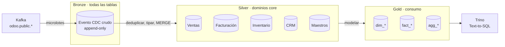
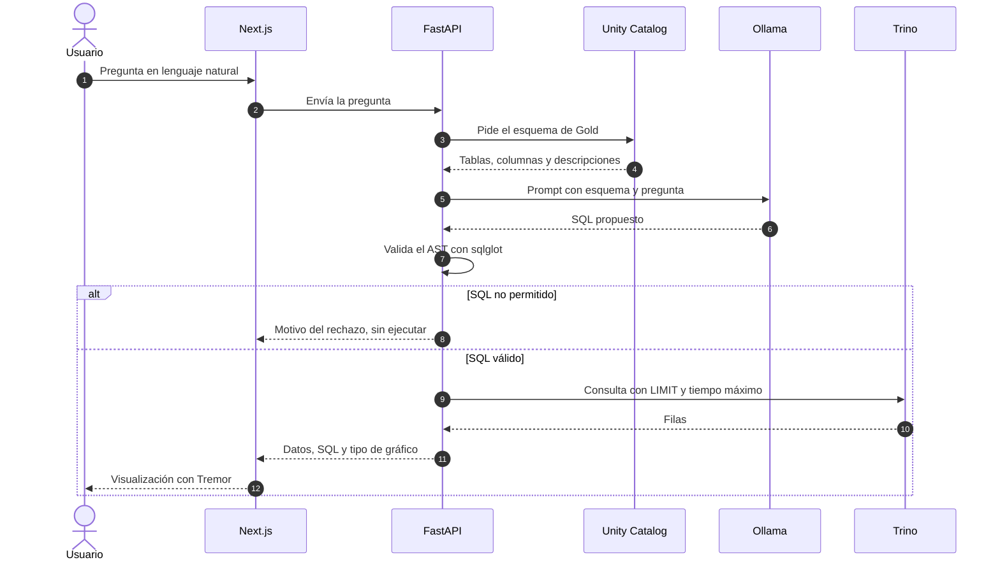

# Arquitectura

Detalle técnico del proyecto. La vista general está en el [README](../README.md#arquitectura) y las reglas de obligado cumplimiento, en [CLAUDE.md](../CLAUDE.md).

## Principios

1. **El ERP no se toca.** La captura lee el WAL de PostgreSQL; no hay consultas analíticas contra Odoo.
2. **Bronze es la fuente de reproceso.** Conserva el evento crudo, así que Silver y Gold se pueden reconstruir.
3. **El hardware manda.** Cada contenedor tiene un límite y la suma cabe en la RAM asignada a WSL.
4. **El SQL del modelo no es de confianza.** Se valida en varias capas antes de ejecutarse.
5. **Formatos abiertos.** Delta Lake sobre S3, sin dependencia de un motor concreto.

## Componentes y versiones

Tags comprobados en sus registros el 2026-11-24.

| Componente | Imagen | Función |
|---|---|---|
| PostgreSQL | `postgres:15.20-bookworm` | Base de datos de Odoo con `wal_level=logical` |
| Odoo | `odoo:17.0-20260908` | ERP de origen ([TD-012](TECHNICAL_DEBT.md#td-012)) |
| Kafka | `apache/kafka:4.3.2` | Bus de eventos en modo KRaft |
| Debezium | `quay.io/debezium/connect:3.7.1.Final` | CDC. Incluye Kafka Connect 4.3.1 |
| MinIO | `cgr.dev/chainguard/minio` (digest) | Almacenamiento S3 ([TD-003](TECHNICAL_DEBT.md#td-003)) |
| Unity Catalog OSS | `unitycatalog/unitycatalog:v0.7.0` | Catálogo de metadatos |
| Trino | `trinodb/trino:484` | Motor de consulta, nodo único |
| Ollama | `ollama/ollama:0.40.18` | LLM local con GPU |
| Worker, backend, frontend | build local | Servicios propios (fases 2 a 5) |

La descarga de las imágenes externas ocupa unos 9 GB comprimidos, más 4,7 GB del modelo.

## Ingesta CDC

Configuración prevista del conector de Debezium (Fase 1):

| Propiedad | Valor | Motivo |
|---|---|---|
| `plugin.name` | `pgoutput` | Incluido en PostgreSQL |
| `schema.include.list` | `public` | Captura global |
| `table.include.list` | sin definir | Captura global |
| `snapshot.mode` | `initial` | Carga inicial y después cambios |
| `decimal.handling.mode` | `string` | Decimales exactos. Por defecto llegan como binario en base64 |
| `heartbeat.interval.ms` | `10000` | Avanza el slot con poco tráfico ([TD-006](TECHNICAL_DEBT.md#td-006)) |
| `topic.creation.default.*` | 1 partición, réplica 1 | El broker no crea topics por su cuenta |
| `column.exclude.list` | por definir | Secretos y credenciales ([TD-004](TECHNICAL_DEBT.md#td-004)) |
| `database.password` | `${env:DEBEZIUM_DB_PASSWORD}` | La contraseña no se escribe en el JSON |

Los topics siguen el patrón `odoo.public.<tabla>`.

## Medallion

| | Bronze | Silver | Gold |
|---|---|---|---|
| Ruta | `s3://bronze/odoo/<tabla>` | `s3://silver/<dominio>/<tabla>` | `s3://gold/<dominio>/<modelo>` |
| Alcance | Todas las tablas | Dominios core | Dominios core |
| Escritura | Append | MERGE por clave primaria | Sobrescritura o MERGE |
| Contenido | Evento crudo | Estado actual tipado | Modelo dimensional |
| Acceso de Text-to-SQL | No | No | Sí, solo lectura |

**Columnas de Bronze:** `_topic`, `_partition`, `_offset`, `_ingested_at`, `op`, `source_lsn`, `source_ts_ms`, `key`, `before` y `after`. Las tres últimas guardan JSON como texto.

**Reglas de procesamiento**

- **Entrega al menos una vez.** El offset de Kafka se confirma después del commit en Delta. Los duplicados se eliminan en Silver por `(_topic, _partition, _offset)`.
- **Orden.** El estado más reciente de una fila es el de mayor `source_lsn`, no el último en llegar.
- **Borrados.** `op = 'd'` marca la fila con `_is_deleted`; no se elimina físicamente en Silver.
- **Valores TOAST.** Debezium envía `__debezium_unavailable_value` cuando un campo largo no ha cambiado. El MERGE conserva el valor anterior y nunca escribe ese marcador.
- **Concurrencia.** Un solo escritor. En MinIO, delta-rs usa escritura condicional (`aws_conditional_put=etag`).

## Catálogo y consulta

Unity Catalog OSS es el catálogo de referencia: `lakehouse.silver` y `lakehouse.gold`, con tablas externas y descripciones de columnas. FastAPI lee de él el esquema que se incluye en el prompt.

Trino 484 no puede usar Unity Catalog OSS como metastore de tablas Delta. La propuesta para el MVP es un metastore en ficheros sobre MinIO con registro por `system.register_table`. Las alternativas y las fuentes están en [TD-002](TECHNICAL_DEBT.md#td-002).

## Text-to-SQL

| Capa | Control |
|---|---|
| Prompt | Solo contiene metadatos de Gold |
| AST (`sqlglot`) | Una sentencia `SELECT` o `WITH`, tablas en lista de permitidas, sin funciones de tabla |
| Backend | `LIMIT` y tiempo máximo obligatorios |
| Trino | Usuario `text2sql` con `SELECT` solo sobre Gold; límites de memoria y duración |
| MinIO | Credenciales de solo lectura para Trino ([TD-014](TECHNICAL_DEBT.md#td-014)) |

El control de acceso de Trino limita lo que puede hacer el usuario `text2sql`, pero no sustituye a la autenticación ([TD-009](TECHNICAL_DEBT.md#td-009)).

## Red y puertos

Red interna `lakehouse`. Los puertos se publican solo en `127.0.0.1`.

| Servicio | Dentro de la red | En el host |
|---|---|---|
| PostgreSQL | `odoo-db:5432` | 5433 |
| Odoo | `odoo:8069` | 8069 |
| Kafka | `kafka:19092` | 9092 |
| Kafka Connect | `kafka-connect:8083` | 8083 |
| MinIO (API / consola) | `minio:9000` / `minio:9001` | 9000 / 9001 |
| Unity Catalog | `unity-catalog:8080` | 8081 |
| Trino | `trino:8080` | 8080 |
| Ollama | `ollama:11434` | 11434 |
| FastAPI | `backend:8000` | 8000 |
| Next.js | `frontend:3000` | 3000 |

## Particularidades de Odoo 17

A confirmar contra el esquema real en la Fase 1:

- **Campos traducibles:** se guardan como JSONB por idioma, por ejemplo `product_template.name`. Silver extrae el idioma configurado, con `en_US` como alternativa.
- **Importes:** columnas `numeric`. Se tratan como `Decimal`, nunca como coma flotante.
- **Fechas:** `timestamp` sin zona horaria, en UTC. Debezium las envía como enteros.
- **Campos por empresa:** algunos, como `product_product.standard_price`, están en `ir_property`.
- **Archivado:** `active = false` no es un borrado.
- **Facturas:** `account_move` mezcla facturas, abonos y asientos. Hay que filtrar por `move_type` y `state = 'posted'`, y las líneas por `display_type`.
- **Pedidos:** en la versión 17, `sale_order` no usa el estado `done`; el bloqueo está en `locked`.

## Decisiones

| Decisión | Motivo | Alternativa descartada |
|---|---|---|
| Worker en Python con delta-rs y Polars | Cabe en 1,5 GB de RAM | Spark Structured Streaming |
| Kafka en modo KRaft | Un proceso menos | Kafka con Zookeeper |
| Captura global en Bronze | Reproceso sin volver a Odoo | Lista cerrada de tablas |
| Delta Lake | Aprobado para el proyecto | Iceberg |
| Trino en un nodo | Presupuesto de RAM | Clúster ([TD-008](TECHNICAL_DEBT.md#td-008)) |
| LLM local | Los datos no salen del host | API externa |
| Perfiles de Compose | Arrancar y validar por capas | Todo el stack a la vez |
| Puertos en `127.0.0.1` | No hay autenticación en el MVP | Exponer en la red local |
